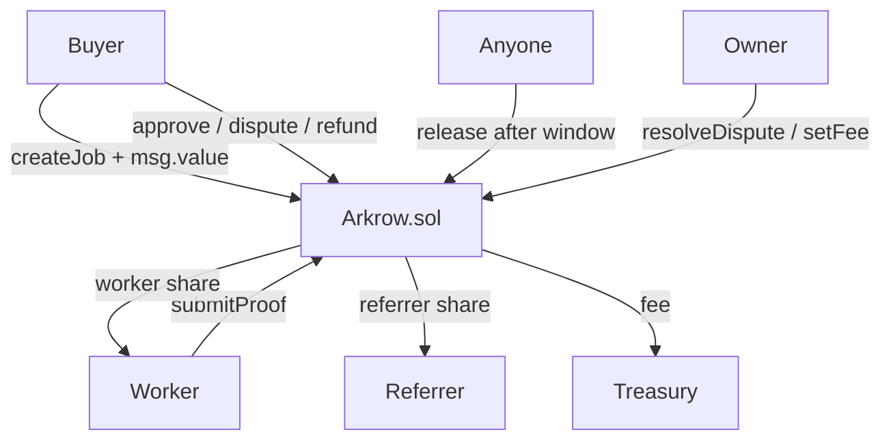

# Arkrow Escrow — Smart Contract Design Document

## 1. Metadata

| Field | Value |
|---|---|
| Status | Draft |
| Authors | Arc Studio |
| Target chain | Arc Testnet (EVM, Paris hardfork) |
| Language / toolchain | Solidity 0.8.28 / Foundry (forge) |
| Milestone | v1.0 — testnet |

Review tracker (check when closed):
- [ ] Design review
- [ ] Security review
- [ ] Ops review
- [ ] Compliance review

---

## 2. Action Items (living)

_(empty at first draft — populated after review rounds)_

---

## 3. Goals / Non-Goals

### Goals
- Enable a buyer (human or AI agent) to hire a worker (human or AI agent) and lock USDC as escrow payment.
- Release escrowed USDC in one atomic transaction: worker share + optional referrer share + treasury fee.
- Allow a buyer to reclaim USDC if the worker misses the submission deadline.
- Give the buyer a dispute window after proof submission; only the contract owner may resolve disputes.
- Track `jobsCompleted` and `totalEarned` per worker address as an onchain reputation signal.
- Emit a full event log for every state change so off-chain indexers can reconstruct job lifecycle.

### Non-Goals
- No off-chain proof verification — `proofHash` is a `bytes32` commitment; the contract does not evaluate it.
- No upgradability (v1 is immutable; a migration path is out of scope).
- No multi-token support (Arc USDC is the only asset).
- No batched job creation.
- No worker registration or KYC.
- No cross-chain bridging.

---

## 4. Requirements

### Functional
- F1 — `createJob(worker, deadline, referrer, referrerBps) payable` locks `msg.value` native USDC.
- F2 — Only the assigned worker may call `submitProof(jobId, proofHash)` before `deadline`.
- F3 — After `submitProof`, the buyer has `REVIEW_WINDOW` seconds to call `dispute(jobId)`.
- F4 — Anyone may call `release(jobId)` after `REVIEW_WINDOW` elapses without a dispute (or buyer calls `approve(jobId)` immediately).
- F5 — On release, funds split atomically: worker share (`amount - fee - referrerShare`), referrer share (if set and `referrerBps > 0`), fee to `treasury`.
- F6 — If no proof by `deadline`, buyer may call `refund(jobId)` to recover the full amount.
- F7 — Only `owner` may call `resolveDispute(jobId, payWorker)`.
- F8 — `jobsCompleted[worker]` and `totalEarned[worker]` incremented on every successful release.
- F9 — Events emitted: `JobCreated`, `ProofSubmitted`, `JobApproved`, `JobReleased`, `JobRefunded`, `JobDisputed`, `DisputeResolved`.

### Security
- S1 — No path allows a non-buyer to call `approve`, `dispute`, or `refund`.
- S2 — No path allows a non-worker to call `submitProof`.
- S3 — Only `owner` may call `resolveDispute`.
- S4 — `ReentrancyGuard` on every function that transfers USDC.
- S5 — Check-effects-interactions on all fund-movement paths.
- S6 — `referrerBps` capped at `MAX_REFERRER_BPS` (e.g. 1000 = 10%).
- S7 — Fee (`feeBps`) capped at `MAX_FEE_BPS` (e.g. 500 = 5%). Set at construction; changeable only by owner.
- S8 — `deadline` must be strictly in the future at job creation.
- S9 — Zero-value jobs are rejected.
- S10 — All `address` args validated as non-zero.
- S11 — State machine strictly enforced; no duplicate transitions.

---

## 5. Terminology & Actors

| Term | Definition |
|---|---|
| Buyer | Account that calls `createJob` and locks USDC |
| Worker | Account assigned by the buyer to complete the job |
| Referrer | Optional account that receives a bps share of payment |
| Treasury | Address receiving protocol fee at release |
| Owner | `Ownable2Step` owner; resolves disputes, sets fee |
| Job | Escrow unit identified by a `uint256 jobId` (counter) |
| ProofHash | `bytes32` commitment the worker submits as delivery evidence |
| Review window | Fixed duration (e.g. 3 days) after proof in which the buyer may dispute |
| feeBps | Protocol fee in basis points, capped at `MAX_FEE_BPS` |
| referrerBps | Referrer share in basis points, capped at `MAX_REFERRER_BPS` |

### Actor trust table

| Actor | On/Off-chain | Trust level | Powers |
|---|---|---|---|
| Buyer | Either | Semi-trusted | Create job, approve, dispute, refund |
| Worker | Either | Semi-trusted | Submit proof |
| Owner | Off-chain key | Trusted | Resolve disputes, set fee, set treasury |
| Referrer | Either | Untrusted | Receives share passively |
| Anyone | Either | Untrusted | Call `release` after review window |

---

## 6. Language / Runtime

- Solidity 0.8.28 (checked arithmetic, custom errors, no assembly needed).
- Foundry (forge 0.2.x); tests in `.t.sol`.
- EVM target: Paris — required by Arc; no `PUSH0`, no `mcopy`, no Cancun-only features.
- OpenZeppelin 5.1.0 (pinned; 5.2+ uses `mcopy` which fails under Paris).
  - `ReentrancyGuard` — mutex on all fund-transfer paths.
  - `Ownable2Step` — two-step owner transfer, no `renounceOwnership`.

---

## 7. Transaction & Execution Model

Every public function is atomic: all state committed or all reverted.

Re-entry surface: `createJob` (receives native USDC), `release`, `refund`, `resolveDispute` (send native USDC). All four are guarded with `nonReentrant`. CEI is enforced: state variables updated before any external call in every function.

Timestamp: `block.timestamp` used for `deadline` comparison and review-window expiry. Arc produces blocks in under a second; ±15 s of miner drift is irrelevant for multi-minute review windows. Timestamps are NOT used for randomness.

---

## 8. Chain Standards & Interfaces

No ERC-20 token standard is implemented. USDC on Arc is the native gas token; the contract receives it via `msg.value` and distributes it with low-level `call`. `SafeERC20` is not needed for native-value transfers.

---

## 9. Architecture Overview

### State-machine diagram

```
OPEN
 │
 ├─(submitProof by worker before deadline)──► PROOF_SUBMITTED
 │                                              │
 │                                    ┌─────────┤
 │                                    │         │
 │                          (dispute  │    (approve or timeout)
 │                           by buyer │         │
 │                           within   │         ▼
 │                           window)  │       RELEASED ◄─────── resolveDispute(payWorker=true)
 │                                    │
 │                                    ▼
 │                                DISPUTED ──► RELEASED (resolveDispute payWorker=true)
 │                                         └► REFUNDED (resolveDispute payWorker=false)
 │
 └─(no proof submitted by deadline)──► OPEN (buyer calls refund)──► REFUNDED
```

### Component diagram (Mermaid)



### Flow of funds

| Step | Who moves what | Invariant |
|---|---|---|
| `createJob` | Buyer sends `msg.value` to contract | `contractBalance += amount` |
| `release` / `resolveDispute(payWorker=true)` | Contract sends worker share, referrer share, fee | `workerShare + referrerShare + feeAmount == amount` |
| `refund` / `resolveDispute(payWorker=false)` | Contract returns full amount to buyer | `refundAmount == amount` |

Resting-state invariant: the contract holds exactly the sum of all `OPEN` and `PROOF_SUBMITTED` and `DISPUTED` job amounts; no funds persist after a job reaches `RELEASED` or `REFUNDED`.

---

## 10. Contract Design

### Roles

| Role | Holder | Permissions | Why it exists |
|---|---|---|---|
| Owner | Single EOA/multisig | `resolveDispute`, `setFeeBps`, `setTreasury`, `transferOwnership` | Dispute arbiter, fee admin |
| Buyer | Per-job | `approve`, `dispute`, `refund` | Initiated the job |
| Worker | Per-job | `submitProof` | Assigned by buyer |

### State machine enum

```
enum Status { OPEN, PROOF_SUBMITTED, RELEASED, REFUNDED, DISPUTED }
```

### Storage layout

```
// Arkrow.sol (non-upgradeable; no gap needed)

struct Job {
    address buyer;          // 20 bytes
    address worker;         // 20 bytes
    address referrer;       // 20 bytes
    uint96  amount;         // 12 bytes — packed with referrer
    uint96  referrerBps;    // 12 bytes
    uint64  deadline;       // 8 bytes
    uint64  proofTime;      // 8 bytes — block.timestamp of submitProof
    Status  status;         // 1 byte (uint8)
    bytes32 proofHash;
}

mapping(uint256 => Job) public jobs;
uint256 public jobCounter;

address public treasury;
uint256 public feeBps;

mapping(address => uint256) public jobsCompleted;
mapping(address => uint256) public totalEarned;

uint256 public constant MAX_FEE_BPS       = 500;   // 5%
uint256 public constant MAX_REFERRER_BPS  = 1000;  // 10%
uint256 public constant REVIEW_WINDOW     = 3 days;
uint256 public constant BPS_DENOMINATOR   = 10_000;
```

### Modifiers

| Modifier | Guard enforced |
|---|---|
| `onlyOwner` (inherited) | `msg.sender == owner()` |
| `nonReentrant` (inherited) | reentrancy mutex |

### Functions — write surface

| Function | Caller | State mutated | Events | Revert conditions |
|---|---|---|---|---|
| `constructor(treasury, feeBps)` | Deployer | Sets `treasury`, `feeBps`, `owner` | — | Zero treasury, feeBps > MAX_FEE_BPS |
| `createJob(worker, deadline, referrer, referrerBps)` | Anyone | Inserts `jobs[++jobCounter]` | `JobCreated` | Zero worker, deadline in past, zero value, referrerBps > MAX_REFERRER_BPS, referrer==zero when referrerBps>0 |
| `submitProof(jobId, proofHash)` | Worker | `jobs[id].proofHash`, `status=PROOF_SUBMITTED`, `proofTime` | `ProofSubmitted` | Not worker, not OPEN, past deadline, zero proofHash |
| `approve(jobId)` | Buyer | (calls `_release` → `status=RELEASED`) | `JobApproved`, `JobReleased` | Not buyer, not PROOF_SUBMITTED |
| `release(jobId)` | Anyone | Calls `_release` | `JobReleased` | Not PROOF_SUBMITTED, review window not expired |
| `refund(jobId)` | Buyer | `status=REFUNDED`, returns amount | `JobRefunded` | Not buyer, not OPEN, deadline not passed |
| `dispute(jobId)` | Buyer | `status=DISPUTED` | `JobDisputed` | Not buyer, not PROOF_SUBMITTED, review window expired |
| `resolveDispute(jobId, payWorker)` | Owner | `status=RELEASED or REFUNDED`, transfers funds | `DisputeResolved`, `JobReleased` or `JobRefunded` | Not owner, not DISPUTED |
| `setFeeBps(newFee)` | Owner | `feeBps` | `FeeUpdated` | feeBps > MAX_FEE_BPS |
| `setTreasury(addr)` | Owner | `treasury` | `TreasuryUpdated` | Zero address |

### Events

| Event | Params | When |
|---|---|---|
| `JobCreated(uint256 indexed jobId, address indexed buyer, address indexed worker, uint256 amount, uint64 deadline)` | — | `createJob` |
| `ProofSubmitted(uint256 indexed jobId, bytes32 proofHash)` | — | `submitProof` |
| `JobApproved(uint256 indexed jobId, address indexed buyer)` | — | `approve` |
| `JobReleased(uint256 indexed jobId, address indexed worker, uint256 workerAmount, uint256 referrerAmount, uint256 feeAmount)` | — | `_release` |
| `JobRefunded(uint256 indexed jobId, address indexed buyer, uint256 amount)` | — | `refund`, `resolveDispute(false)` |
| `JobDisputed(uint256 indexed jobId, address indexed buyer)` | — | `dispute` |
| `DisputeResolved(uint256 indexed jobId, bool payWorker)` | — | `resolveDispute` |
| `FeeUpdated(uint256 oldFee, uint256 newFee)` | — | `setFeeBps` |
| `TreasuryUpdated(address oldTreasury, address newTreasury)` | — | `setTreasury` |

---

## 11. Specification tables

### 11.1 Escrow Principles (always hold)
1. A job in `RELEASED` or `REFUNDED` state holds zero funds in the contract.
2. `workerShare + referrerShare + feeAmount == job.amount` on every release.
3. Only the worker of a job may advance it from `OPEN` to `PROOF_SUBMITTED`.
4. Only the buyer may advance from `PROOF_SUBMITTED` to `DISPUTED`.
5. Only the owner may resolve a `DISPUTED` job.

### 11.2 Functionalities

| Functionality | Restriction | Note | Event |
|---|---|---|---|
| Create job | Anyone with USDC | Locks msg.value | `JobCreated` |
| Submit proof | Assigned worker only, before deadline | Zero proof rejected | `ProofSubmitted` |
| Approve release | Buyer only, after proof | Short-circuits review window | `JobApproved`, `JobReleased` |
| Auto-release | Anyone, after review window with no dispute | Time-lock safety | `JobReleased` |
| Refund | Buyer only, after deadline with no proof | Full amount returned | `JobRefunded` |
| Dispute | Buyer only, within review window | Escalates to owner | `JobDisputed` |
| Resolve dispute | Owner only | Binary: pay worker or refund buyer | `DisputeResolved`, `JobReleased`/`JobRefunded` |
| Set fee | Owner only | Capped at MAX_FEE_BPS | `FeeUpdated` |
| Set treasury | Owner only | Non-zero only | `TreasuryUpdated` |

---

## 12. Deployment & Initialization

Constructor args: `address treasury`, `uint256 feeBps`.

- `treasury` must be non-zero; set to the platform deployer wallet at deploy time.
- `feeBps` must be ≤ 500 (5%).
- Contract is immutable (no proxy).
- `Ownable2Step` owner is the deployer.

Init runbook:
1. Deploy with `(treasury, feeBps)`.
2. Verify constructor did not revert.
3. Optionally transfer ownership to a multisig via `transferOwnership` → `acceptOwnership`.

---

## 13. Upgradeability

Not upgradeable (v1). Migration story: deploy a new contract; buyers create new jobs there. Old jobs complete naturally; no dual-run needed because jobs are self-contained.

---

## 14. Key Management & Signing

No off-chain signatures used. All auth is `msg.sender` comparison. Owner key should be a multisig or hardware wallet in production.

---

## 15. Security Considerations

| Vulnerability | Applicable? | Mitigation |
|---|---|---|
| Reentrancy | Yes — native value transfers in `_release`, `refund`, `resolveDispute` | `nonReentrant` on all three + CEI ordering |
| Access control | Yes — buyer/worker/owner gating | `require(msg.sender == job.buyer/worker)`, `onlyOwner` |
| Integer overflow/underflow | Solidity 0.8 checked | No `unchecked` blocks |
| Unchecked external call | Yes — low-level `call` for native transfers | Return value checked; revert on failure |
| Fee-on-transfer / rebasing tokens | N/A — native USDC only | `msg.value` is exact |
| Signature replay | N/A — no off-chain signatures | — |
| Front-running / MEV | Low — deadline is block.timestamp; no ordering-sensitive value path | Review window is 3 days; ±seconds irrelevant |
| Flash-loan / price manipulation | N/A — no price oracle | — |
| Oracle manipulation | N/A | — |
| Denial of service | Low — push payments to single recipient; no loops | Each release sends to at most 3 addresses; send failure reverts and retries via resolveDispute |
| Delegatecall / proxy safety | N/A — no proxy | — |
| Timestamp / block dependence | Low — deadlines use block.timestamp | Tolerances are minutes to days; miner drift irrelevant |
| Approval persistence | N/A — no ERC-20 approval path | Native value only |
| Centralization risk | Medium — owner resolves all disputes | Accept for v1; document; upgrade path: multisig + timelock |
| Zero-amount job | Yes — rejected | `require(msg.value > 0)` |
| Self-referral (worker == referrer) | Medium | Allowed by design; capped at 10%; acceptable |
| Treasury send failure | Low | Low-level call checked; owner can update treasury if broken |

---

## 16. Trust Model & Threat Analysis

| Actor | Max damage if key compromised | Mitigation | Detection |
|---|---|---|---|
| Owner | Resolve all disputes adversarially; drain disputed escrow to wrong party; change fee to 5% | Multisig + timelock in production | `DisputeResolved` events |
| Buyer | Refuse to approve; force dispute on all their own jobs | Dispute resolution by owner; auto-release after window | `JobDisputed` spike |
| Worker | Submit garbage proofHash | Owner resolves disputes; buyer may dispute | `ProofSubmitted` then `JobDisputed` |
| Treasury address | If poisoned: fee `call` fails, releases revert | Owner can `setTreasury` to a working address | Fee transfer failure |

---

## 17. Emergency Response & Circuit Breakers

No pause mechanism in v1 (by design — pausing escrow traps user funds). Emergency actions:
- If treasury address is broken: owner calls `setTreasury(newAddr)`.
- If fee is wrong: owner calls `setFeeBps(newFee)`.
- No `rescueTokens` needed — contract only holds native USDC locked in jobs; mistakenly sent extra value is recoverable by the owner via an explicit `rescueExcessNative` function (added as a convenience; does not touch job balances).

---

## 18. Failure Scenarios

- **Treasury send fails on release:** `_release` reverts; job stays in current state; owner updates treasury, buyer or anyone retries `release`/`approve`/`resolveDispute`.
- **Worker send fails on release:** Same revert; owner resolves dispute, or buyer calls `approve` again after treasury fixed.
- **Buyer never disputes and never approves:** Auto-release triggers after `REVIEW_WINDOW`; worker receives funds.
- **Worker misses deadline:** Buyer calls `refund`; full amount returned.
- **Dispute and owner key lost:** Job stays `DISPUTED` indefinitely — accept risk for v1; multisig mitigates.

---

## 19. Priorities & Tradeoffs

| Decision | Tradeoff | Rationale |
|---|---|---|
| Native USDC (not ERC-20) | Simpler, fewer attack surface paths vs. no `SafeERC20` | Arc's USDC IS the native token; avoids double-counting risk |
| Push payments | Failure traps job in current state vs. pull-pattern complexity | Acceptable: only 3 recipients; owner can fix treasury |
| No pause | Users can't be locked out vs. no circuit breaker | Pausing escrow traps real funds; owner-level emergency actions suffice |
| Immutable v1 | No upgrade path vs. bug exposure | Forces conservative design; migration path is new deploy |
| Owner resolves disputes | Centralized arbiter vs. complex DAO/oracle | Acceptable for v1; upgrade path is multisig/timelock |
| `uint96 amount` | 79 billion USDC (9 decimals on Arc) max per job vs. gas savings from struct packing | Arc native USDC has 18 decimals; need `uint256` for amount — pack only referrerBps as uint96 |

Note on uint256 vs packing: Arc native USDC has 18 decimals, so even 1 USDC = 1e18 wei-equivalent. `uint96` (max ~79 billion × 1e9) would overflow at amounts > ~79 USDC if the full 18-decimal representation is used. The storage struct will use `uint256 amount` to be safe.

---

## 20. Testing Strategy

Coverage target: 100% branch coverage on all state-machine transitions.

Tests (Foundry):
- `createJob`: happy path, revert on zero worker, revert on past deadline, revert on zero value, revert on referrerBps overflow, revert on referrer=zero when referrerBps>0.
- `submitProof`: happy path, revert if not worker, revert if not OPEN, revert if past deadline.
- `approve`: happy path, revert if not buyer, revert if not PROOF_SUBMITTED.
- `release`: happy path after window, revert before window, revert if not PROOF_SUBMITTED.
- `refund`: happy path after deadline, revert if not buyer, revert if not OPEN, revert if deadline not passed.
- `dispute`: happy path, revert if not buyer, revert if not PROOF_SUBMITTED, revert if window expired.
- `resolveDispute`: both branches (payWorker true/false), revert if not DISPUTED, revert if not owner.
- `setFeeBps` / `setTreasury`: happy paths and reverts.
- Fuzz: `createJob` amount, `feeBps`, `referrerBps`; arithmetic invariant `workerShare + referrerShare + feeAmount == amount`.
- Invariant: contract balance >= sum of all locked job amounts.

---

## 21. Third-Party Libraries

| Library | Version | Dependency? | Why | Audited? |
|---|---|---|---|---|
| `@openzeppelin/contracts` | 5.1.0 | Yes (pinned) | `ReentrancyGuard`, `Ownable2Step` | Yes (OZ audited) |

---

## 22. Monitoring & Alerting

| Event | Threshold | Severity | Playbook |
|---|---|---|---|
| `JobDisputed` | > 5/day | High | Review dispute queue; check for buyer griefing |
| `DisputeResolved` | Any | Medium | Log outcome; check treasury balance |
| `FeeUpdated` | Any | High | Verify owner intent; alert if unexpected |
| `TreasuryUpdated` | Any | Critical | Verify owner intent immediately |

---

## 23. Cross-Functional Stakeholders

| Stakeholder | Review owns |
|---|---|
| Security | §15, §16, §17, §18 |
| Product | §3, §4, §5 |
| Ops | §12, §17, §22 |
| Legal/Compliance | §5 (actor trust), §19 (tradeoffs) |

---

## 24. Message Encoding

N/A — no cross-chain message-passing.

---

## 25. Types & Enums

```solidity
enum Status { OPEN, PROOF_SUBMITTED, RELEASED, REFUNDED, DISPUTED }

struct Job {
    address buyer;
    address worker;
    address referrer;
    uint256 amount;
    uint256 referrerBps;
    uint64  deadline;
    uint64  proofTime;
    Status  status;
    bytes32 proofHash;
}
```

---

## 26. Common Patterns / Worked Examples

### Happy path: job created, proof submitted, auto-released

1. Buyer calls `createJob(worker, deadline, referrer, 200)` with `msg.value = 1000 USDC (native)`. `jobId = 1` created. `JobCreated` emitted.
2. Worker calls `submitProof(1, 0xabc...)`. Status → `PROOF_SUBMITTED`. `proofTime = block.timestamp`. `ProofSubmitted` emitted.
3. 3 days pass. Anyone calls `release(1)`. `_release` runs: fee = 50, referrerShare = 20, workerShare = 930. Transfers execute. Status → `RELEASED`. `JobReleased` emitted. `jobsCompleted[worker]++`, `totalEarned[worker] += 930`.

### Dispute path

1–2 same as above.
3. Buyer calls `dispute(1)` within 3 days. Status → `DISPUTED`. `JobDisputed` emitted.
4. Owner calls `resolveDispute(1, true)` (pay worker). `_release` runs. `DisputeResolved` + `JobReleased` emitted.
